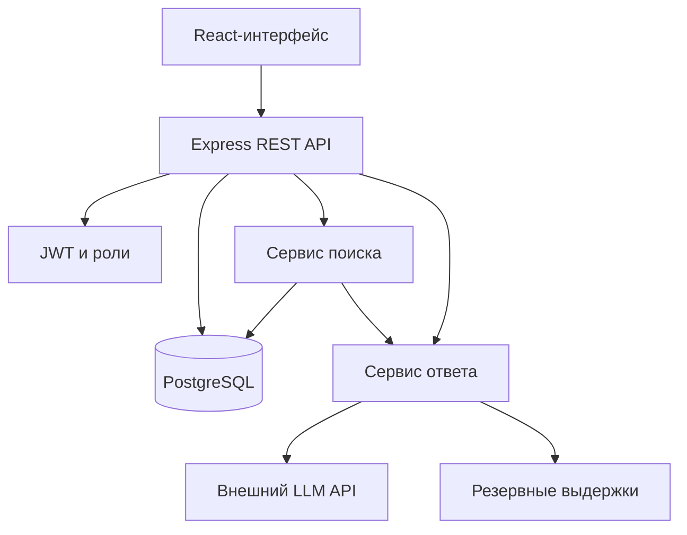
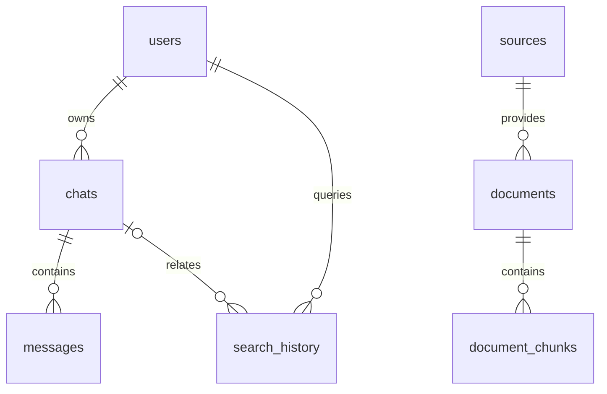

# Разработка ИИ-помощника по налоговым изменениям

Пояснительная записка к программной реализации курсового проекта.

Авторы по техническому заданию: Мухамедзянов Матвей, Данила Марченков.

## Введение

Изменения нормативных документов затрудняют поиск актуальной информации. Пользователь должен определить применимость нормы, дату вступления в силу и условия действия. Обычный поиск возвращает документы, но не всегда помогает быстро выделить важные положения. Языковая модель может объяснять текст, однако без внешнего контекста способна сформировать неподтверждённый ответ.

Цель проекта — разработать веб-приложение, которое объединяет поиск по подготовленному корпусу документов с формированием понятного ответа и сохранением ссылок на найденные фрагменты. Объект разработки — процесс поиска и объяснения налоговых изменений. Предмет — клиент-серверная система с полнотекстовым поиском и подключаемой LLM.

В рамках реализации выделены задачи проектирования базы данных, разработки REST API, создания интерфейса, реализации аутентификации, подготовки поискового контекста и проверки основных сценариев. Реализация предназначена для учебного использования. Полнота и актуальность нормативного корпуса зависят от документов, добавленных администратором.

## 1. Анализ требований

Система поддерживает роли пользователя и администратора. Пользователь регистрируется, входит в систему, изменяет отображаемое имя, создаёт диалоги и задаёт вопросы. Администратор дополнительно управляет доступом обычных пользователей, источниками и импортом документов, просматривает статистику и историю поисковых запросов.

В ответе необходимо различать найденный факт, вывод языковой модели и отсутствие подтверждения. Поэтому приложение использует четыре режима: ответ LLM, прямые выдержки, резервный вывод выдержек после ошибки LLM и сообщение о недостаточности данных. Учебные документы маркируются отдельно и исключаются из поиска по умолчанию.

| Требование ТЗ | Реализация |
|---|---|
| Регистрация, вход, выход | Express, bcrypt, JWT, отзыв по версии токена |
| Просмотр и изменение профиля | Страница личного кабинета, изменение имени |
| Диалог и история | Таблицы chats/messages, маршруты React Router |
| Краткий и подробный ответ | Параметр detail для LLM и выдержек |
| Уточняющие вопросы | Последние сообщения в контексте LLM, повторный поиск для явных уточнений |
| Поиск документов и фрагментов | PostgreSQL FTS, русский словарь, GIN |
| Дата и актуальность | publication/effective dates и активность источника |
| Отображение источников | Карточки цитат, ссылки, даты, исходные фрагменты |
| Административные функции | Источники, импорт JSON, блокировка пользователей, статистика |
| Модульная структура | controllers, services, models, middleware |
| PostgreSQL и pg | Рабочий драйвер pg, SQL-схема из семи сущностей |
| Семантический поиск | Не обязателен по ТЗ; в эту версию не включён |

Принятые ограничения: корпус пополняется вручную; нет автоматического парсинга сайтов; импорт выполняется в JSON; доступ администратора создаётся из переменных окружения. Это конкретизирует не заданные в исходном ТЗ способы наполнения корпуса.

## 2. Архитектура

Приложение состоит из браузерного клиента React и сервера Express. В рабочем режиме Express отдаёт собранные статические файлы и API с одного origin. Vite используется для разработки и сборки клиента. Сервер обращается к PostgreSQL через пул соединений pg. Внешняя модель подключается через HTTP-адаптер и может быть заменена без изменения интерфейса.

Контроллеры принимают запросы, выполняют валидацию и координируют бизнес-сценарии. Модельный слой содержит схему и транзакционный помощник. Поисковый сервис возвращает только выбранные фрагменты. Сервис ответа не управляет сессией пользователя и не сохраняет сообщения самостоятельно. Это упрощает независимую проверку компонентов.

## 3. Модель данных

Схема включает семь таблиц. users хранит профиль, хеш пароля, роль, состояние доступа и версию токена. chats связывает диалог с владельцем. messages хранит текст, роль, время, режим генерации и снимок цитат. sources описывает источник и состояние его участия в поиске. documents хранит текст, даты и дополнительные метаданные. document_chunks содержит поисковые фрагменты. search_history фиксирует запрос, выбранную дату, число результатов и длительность обработки.

Внешние ключи поддерживают ссылочную целостность. Удаление диалога каскадно удаляет сообщения; связь поисковой истории с ним становится NULL. Удаление документа удаляет его фрагменты, но сохранённые цитаты в сообщениях остаются как исторический снимок. Такая история не подтверждает текущую применимость удалённой редакции.

Поисковый вектор вычисляется PostgreSQL как generated stored column. Индекс GIN ускоряет отбор по лексемам. Дополнительные индексы обслуживают выборки сообщений диалога и диалогов пользователя. JSONB используется для цитат и метаданных: demo и imported_by.

## 4. Поиск и подготовка ответа

При импорте название и текст объединяются, затем разделяются на фрагменты длиной до 1200 символов с перекрытием 160 символов. Перекрытие уменьшает потерю контекста на границе, но не заменяет смысловое деление документа. В будущей версии целесообразно выделять статьи и пункты.

Естественно-языковой запрос преобразуется функцией websearch_to_tsquery с русской конфигурацией. PostgreSQL сравнивает запрос с tsvector каждого фрагмента. Отбор ограничивается активными источниками, публикацией не позднее выбранной даты, начавшимся периодом действия и отсутствием истёкшего периода. Признак demo учитывается отдельно.

Результаты ранжируются по ts_rank_cd, затем по дате публикации и id; возвращаются шесть фрагментов. Полнотекстовый поиск учитывает морфологию, однако не понимает смысл так же, как эмбеддинги. Неудачный запрос можно уточнить, используя термины документа. Для явных коротких уточнений сервис повторно ищет по последнему вопросу пользователя.

При отсутствии результатов модель не вызывается. Пользователь получает сообщение об ограниченности загруженной базы. Если ключ не настроен, выводятся найденные выдержки. При наличии ключа модель получает системную инструкцию, вопрос, последние сообщения и фрагменты как данные. В инструкции запрещены неподтверждённые сведения и выполнение инструкций из документов.

Модель должна вернуть JSON с текстом и перечнем id фрагментов. Сервер проверяет схему, наличие ссылок и принадлежность id найденным результатам. Ошибка схемы, неизвестная ссылка, тайм-аут или ошибка провайдера переводят ответ в резервный режим. Эта проверка защищает от выдуманных идентификаторов, но не гарантирует, что каждая фраза корректно интерпретирует первоисточник.

Вопрос и ответ сохраняются одной транзакцией вместе с поисковой статистикой и обновлением названия диалога. Так история не содержит завершённого ответа без соответствующего вопроса. Генерация ограничена одним одновременным запросом на диалог внутри одного процесса.

## 5. Аутентификация и безопасность

Пароль проходит проверку длины и хешируется bcrypt с cost 12. Ограничение 72 байта учитывает поведение bcrypt. SQL-параметры передаются отдельно от текста запросов. Пользовательские данные не интерполируются в SQL. Валидация JSON выполняется Zod.

JWT подписывается HS256 с issuer, audience и сроком восемь часов. При каждом защищённом запросе проверяются подпись, активность пользователя и версия токена. Выход увеличивает версию и делает ранее выданные токены недействительными. Блокировка и разблокировка также меняют версию. Роль читается из базы, а не из тела регистрации.

Перед чтением, записью и удалением диалога проверяется владелец. Другому пользователю возвращается 404. Административные маршруты требуют роли admin. Администраторов нельзя блокировать через предоставленный маршрут. HTML ответа не исполняется: React выводит текст, а ссылки поступают из проверенных по формату полей импорта.

Helmet задаёт защитные HTTP-заголовки. Лимиты ограничивают попытки входа и генерации. Секреты передаются через окружение и не входят в frontend bundle. Внешнему LLM-провайдеру доступны переданные вопросы и фрагменты, поэтому при реальном внедрении требуется определить допустимый состав данных и условия их обработки.

## 6. Пользовательский интерфейс

Интерфейс состоит из формы входа/регистрации, рабочего пространства помощника, каталога источников, личного кабинета и панели администратора. Боковое меню содержит историю. В мобильной версии оно скрывается за кнопкой меню. Поле вопроса сопровождается датой, выбором подробности и переключателем учебных данных.

Ответы разделены по ролям. Карточка источника раскрывает фрагмент, даты и точную ссылку. Пользователь видит, какой режим использован: модель, выдержки или недостаток данных. При отправке кнопка блокируется, а интерфейс показывает ожидание. Ошибки отображаются рядом с формой.

Административная панель содержит статистику, управление источниками, загрузку JSON, таблицу пользователей и последние поисковые запросы. Для безопасности отсутствуют встроенные рабочие пароли; начальные реквизиты задаёт человек, запускающий приложение.

## 7. Проверка реализации

Автоматические тесты используют Supertest и PGlite — встраиваемый движок PostgreSQL для проверки реальной SQL-схемы без отдельного сервера. Проверяются русская морфология, периоды действия, исключение учебных данных, импорт, транзакционные ограничения, права доступа и отзыв сессий. Вызовы LLM в тестах подменяются контролируемыми HTTP-ответами: это проверяет адаптер и защитные ветки, но не качество реальной модели.

Результаты конкретного прогона, проверка интерфейса и непроверенные части приведены в TESTING.md. Нельзя считать успешную компиляцию подтверждением юридической правильности ответа, полноты базы или устойчивости под нагрузкой.

## 8. Развёртывание и сопровождение

Docker Compose запускает приложение и PostgreSQL 17. База хранится в именованном томе. Контейнер приложения ожидает готовности БД, создаёт отсутствующие таблицы и при необходимости начального администратора. Начальная схема идемпотентна, но полноценный механизм миграций между будущими версиями не реализован.

В README приведены команды сборки, запуска и остановки. Для дальнейшего развития предусмотрены модульность адаптера LLM и отделённый поиск. Возможные направления: автоматизированный импорт из разрешённых официальных каналов, версии нормативных документов, семантический поиск, оценочный набор вопросов, фоновые задачи и распределённые ограничения запросов.

## Заключение

Реализовано клиент-серверное приложение с авторизацией, историей диалогов, полнотекстовым поиском, ссылками на документы, подключаемой LLM и административным управлением. Выбранные технологии соответствуют техническому заданию: React, TypeScript, Express, Node.js, PostgreSQL, pg, JWT и bcrypt. Приложение отделяет учебные сведения от реальных источников и явно обозначает отсутствие подтверждения. Практическая применимость зависит от качества корпуса и проверки результатов человеком.

## Источники технических сведений

1. PostgreSQL 17. Controlling Text Search. https://www.postgresql.org/docs/17/textsearch-controls.html
2. Express. Production Best Practices: Security. https://expressjs.com/advanced/best-practice-security/
3. Исходное техническое задание, предоставленное заказчиком учебного проекта.

Титульный лист, сведения о вузе и руководителе, требования ГОСТ и объём пояснительной записки необходимо оформить по методическим указаниям кафедры. Эта записка описывает фактически поставленный исходный код, а не обещанные будущие функции.
